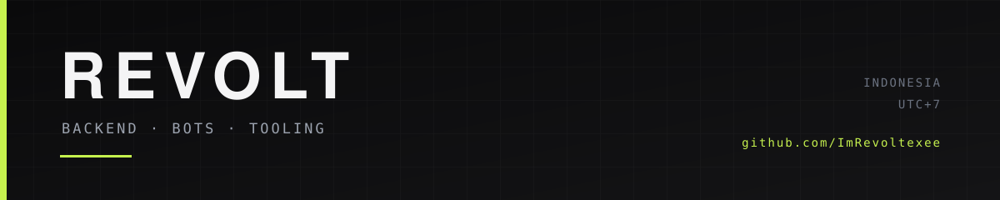

 

Backend, bots and tooling. Python · TypeScript · PHP.

## Selected work

ordered by stars, refreshed automatically — last build 2026-11-09 10:39 UTC

<table>
<tr>
<td width="50%" valign="top">

**[gonka-autoinject](https://github.com/ImRevoltexee/gonka-autoinject)** GonkaRouter account farm + 9Router auto-inject daemon. Full registration flow, key verification, systemd un... `Python` 

</td>
<td width="50%" valign="top">

**[revolt-relay](https://github.com/ImRevoltexee/revolt-relay)** MovieBox backend relay for REVOLT-STREAM (card-free egress) `JavaScript` 

</td>
</tr>
<tr>
<td width="50%" valign="top">

**[umkm-laravel](https://github.com/ImRevoltexee/umkm-laravel)** UMKM Store — Laravel 13: katalog, keranjang, checkout, panel admin (SQLite) `Blade` 

</td>
<td width="50%" valign="top">

**[warung-tools](https://github.com/ImRevoltexee/warung-tools)** Tools gratis + REST API publik buat anak Indonesia. Neo-brutalism, zero dependency, Vercel free tier. `HTML` 

</td>
</tr>
<tr>
<td width="50%" valign="top">

**[Revolt-Guard](https://github.com/ImRevoltexee/Revolt-Guard)** Telegram group protection dashboard with anti-link, moderation tools, announcement system, and owner contro... `TypeScript` 

</td>
<td width="50%" valign="top">

**[REVOLT-HUNTER](https://github.com/ImRevoltexee/REVOLT-HUNTER)** Open-source reconnaissance and bug bounty automation toolkit for VPS, Linux, and Termux environments. `Shell` 

</td>
</tr>
</table>

everything else: [repositories](https://github.com/ImRevoltexee?tab=repositories)

## Stack

## Elsewhere

