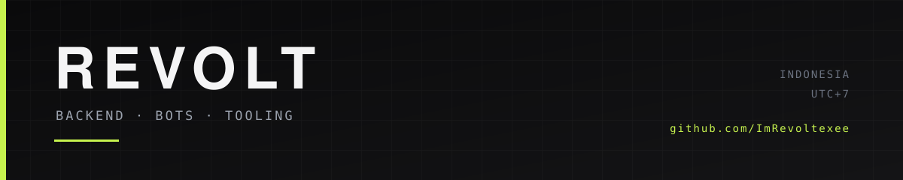

 

Backend, bots and tooling. Python · TypeScript · PHP.

## Selected work

ordered by stars, refreshed automatically — last build 2026-11-28 11:09 UTC

<table>
<tr>
<td width="50%" valign="top">

**[gonka-autoinject](https://github.com/ImRevoltexee/gonka-autoinject)** GonkaRouter account farm + 9Router auto-inject daemon. Full registration flow, key verification, systemd un... `Python` 

</td>
<td width="50%" valign="top">

**[makefun-guide](https://github.com/ImRevoltexee/makefun-guide)** A beginner-friendly getting-started guide to make.fun — how to sign up, connect your AI coding agent, enter... `-` 

</td>
</tr>
<tr>
<td width="50%" valign="top">

**[Makefun-thankful-judge](https://github.com/ImRevoltexee/Makefun-thankful-judge)** Entry for make.fun bounty make-the-ai-judge-feel-thankful-20261127-1600 `Python` 

</td>
<td width="50%" valign="top">

**[Makefun-household-budget-20261126](https://github.com/ImRevoltexee/Makefun-household-budget-20261126)** Household budget site entry for make.fun best-household-budget-site-20261126-1457 `JavaScript` 

</td>
</tr>
<tr>
<td width="50%" valign="top">

**[Makefun-news-20261124](https://github.com/ImRevoltexee/Makefun-news-20261124)** Newspaper-style infographic of the world's news on 24 November 2026, built for the make.fun news-image bounty. `Python` 

</td>
<td width="50%" valign="top">

**[revolt-relay](https://github.com/ImRevoltexee/revolt-relay)** MovieBox backend relay for REVOLT-STREAM (card-free egress) `JavaScript` 

</td>
</tr>
</table>

everything else: [repositories](https://github.com/ImRevoltexee?tab=repositories)

## Stack

## Elsewhere

